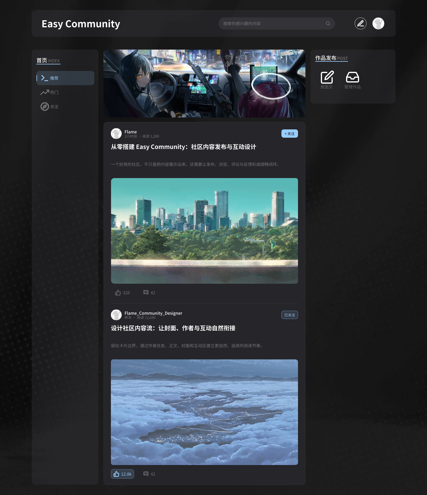
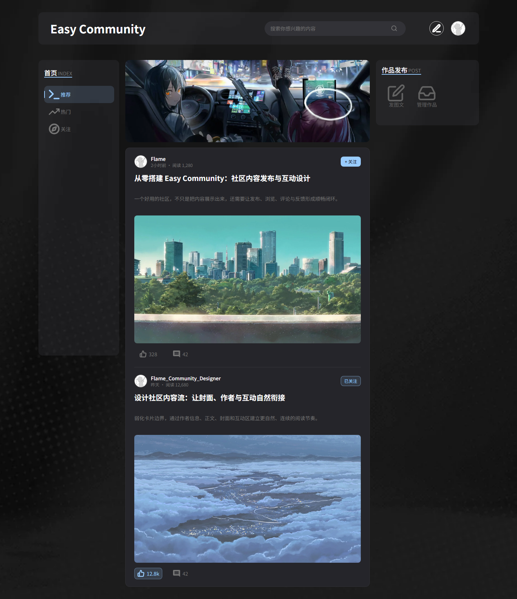

# Easy Community · Figma to Code

<p align="center">
  <a href="./README.md">中文</a> · <strong>English</strong>
</p>

This Figma-to-code project uses [figma-local-agent](https://github.com/Lancasteerr/figma_bridge_agent) to turn a Figma design into a React page. The agent reads the selected design scope's structure, layout, styles, text, assets, and visible states to implement the **Easy Community** desktop homepage with React, TypeScript, and Vite.

The project focuses on design reproduction, reusable components, and lightweight frontend interactions. It does not include a backend service.

## Example Prompt

> Use React to recreate the currently selected page in Figma with pixel-perfect fidelity, using [@figma-local-agent](plugin://figma-local-agent@figma-bridge-marketplace). If any interaction behavior is unclear, such as scrolling, clicking, or selection-state changes, confirm the expected behavior with me before implementing it.

## Important Notes

> [!IMPORTANT]
> **Before implementation begins, review the acceptance checks in the agent's work plan.** Verification should primarily use facts supplied by the plugin, including structure, dimensions, layout, typography, colors, assets, and visible states, together with necessary browser-property and interaction checks. Avoid extensive screenshot-based, visual-tool-based, or eyeball verification. The screenshots below illustrate the result; they do not establish reproduction accuracy.

- Before using the plugin, ensure Figma Desktop is connected to the local Bridge and select the design scope to implement.
- Static Figma facts do not define runtime behavior by themselves. Confirm unclear scrolling, click outcomes, or selection changes before implementation.
- A `FRESH` result only means that the design source used by the implementation has not changed. It does not prove that the code reproduces the design correctly or that interactions have passed verification.
- Read facts by relevant node and field rather than repeatedly loading the entire design tree into context.

## Result Showcase

These images were captured again on October 18, 2026. They show the current homepage design and frontend implementation, both at 1440 × 1668.

<table>
  <thead>
    <tr>
      <th width="50%">Figma Design</th>
      <th width="50%">Current Frontend Implementation</th>
    </tr>
  </thead>
  <tbody>
    <tr>
      <td></td>
      <td></td>
    </tr>
  </tbody>
</table>

The selected navigation item's blue indicator has a known outward offset of about 1px. This documentation update preserves the actual result. See the [detailed verification record (Chinese)](./docs/verification.md) for sources, check coverage, screenshot details, and known differences.

## Highlights

- Implements the header, search field, category sidebar, publishing panel, and a continuous feed containing two articles.
- Reuses separate components for article items, buttons, icons, section titles, and toast messages.
- Recommended, Popular, and Following categories switch their local highlight without filtering or reordering articles.
- Follow and like states can be toggled repeatedly, with like counts updated accordingly. Refreshing restores the initial design states.
- Search, article, comment, publishing, content-management, and profile controls show lightweight messages without page navigation.
- Keeps the header and sidebars in place during vertical scrolling. Narrow viewports allow horizontal scrolling; wide viewports center the content while an independent fixed background covers the viewport.
- Uses plugin-exported images and SVG icons, plus a local font. Primary buttons support keyboard operation and expose selection semantics.

## Tech Stack

| Category | Technology |
| --- | --- |
| UI | React 19 |
| Language | TypeScript 5.9 |
| Build tool | Vite 7 |
| Styling | CSS |
| Font | Local Noto Sans SC variable-font subset with SIL OFL license text |

## Getting Started

Requires Node.js 22.12+ or a compatible newer version, and npm.

```sh
npm ci
npm run dev
```

The development server defaults to [http://127.0.0.1:5173/](http://127.0.0.1:5173/) and listens on local IPv4. If that port is occupied, choose another with `npm run dev -- --port 5174`.

## Available Scripts

| Command | Description |
| --- | --- |
| `npm run dev` | Start the local development server |
| `npm run typecheck` | Run TypeScript type checks |
| `npm run build` | Run type checks and generate a production build |
| `npm run preview` | Preview the production build locally |

## Project Structure

```text
.
├── docs/
│   ├── figma/            # Plugin facts, asset inventory, and node-to-code mappings
│   ├── images/           # Current design and webpage showcase images
│   └── verification.md   # Detailed behavior, checks, and known differences
├── public/
│   ├── assets/           # Plugin-exported original images and SVG icons
│   └── fonts/            # Local font subset and license text
├── src/
│   ├── components/       # Reusable page components
│   ├── data/             # Demo articles and category configuration
│   ├── hooks/            # Toast timing and cleanup
│   ├── App.tsx           # Page composition and interaction state
│   ├── main.tsx          # React entry point
│   └── styles.css        # Page layout and component styles
├── package.json
└── vite.config.ts
```

## Project Scope

- Implements only homepage node `84:673`; adjacent component examples serve as state references.
- Provides no backend APIs, account system, persistence, or article detail pages. Interaction data lives in the current page's memory.
- Follows the 1440px desktop canvas. Narrow viewports preserve the desktop layout instead of switching to a single-column mobile layout.
- The banner is a single static image. Scrolling, clicks, messages, and state changes follow behavior already confirmed with the user.
- Verification covers selected primary layouts and states; it does not claim exhaustive node-by-node or discrepancy-free reproduction. See the [detailed record in Chinese](./docs/verification.md).
