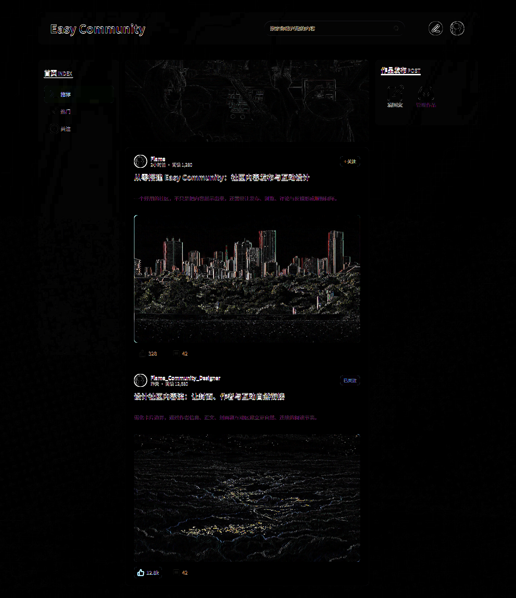

# Easy Community · Figma to Code

<p align="center">
  <a href="./README.md">中文</a> · <strong>English</strong>
</p>

This repository is a design-to-code showcase built with [figma_bridge_agent](https://github.com/Lancasteerr/figma_bridge_agent). It recreates the desktop homepage of **Easy Community** by using a Coding Agent to read and understand the Figma design context, then implementing the result with React, TypeScript, and Vite.

The project focuses on the visual result, reusable component structure, and lightweight frontend interactions. It does not include a backend service.

## Design Reproduction

The following comparison shows the 1440px Figma design and the frontend implementation:

<table>
  <thead>
    <tr>
      <th width="50%">Figma design</th>
      <th width="50%">Frontend implementation</th>
    </tr>
  </thead>
  <tbody>
    <tr>
      <td></td>
      <td></td>
    </tr>
  </tbody>
</table>

<details>
  <summary>View the enhanced visual diff</summary>
  <br />
  <p>The diff amplifies pixel-level differences between both images. Brighter outlines indicate remaining visual differences, while darker areas are closer to the source design.</p>
  
</details>

## Highlights

- Recreates the desktop header, search area, sidebar, publishing panel, and article feed.
- Splits article cards, sidebar navigation, the site header, and the publishing panel into reusable components.
- Supports local selection changes between the Recommended, Trending, and Following navigation items.
- Supports search input, follow-state toggles, and like-state and count updates.
- Uses local images, SVG icons, and Noto Sans SC font assets to match the visual design.
- Adds semantic labels and keyboard focus states to key controls, with component tests for the main interactions.

## Tech Stack

| Category | Technology |
| --- | --- |
| UI | React 19 |
| Language | TypeScript 6 |
| Build tool | Vite 8 |
| Styling | CSS |
| Font | Noto Sans SC |
| Testing | Vitest, Testing Library, jsdom |

## Getting Started

### Requirements

- Node.js `^20.19.0` or `>=22.12.0`
- npm

### Install and run

```bash
npm install
npm run dev
```

The development server runs at [http://127.0.0.1:5173](http://127.0.0.1:5173) by default.

## Available Scripts

| Command | Description |
| --- | --- |
| `npm run dev` | Start the local development server |
| `npm run build` | Run TypeScript checks and create a production build |
| `npm run lint` | Check the codebase with ESLint |
| `npm run test` | Run all component tests |
| `npm run test:watch` | Run tests in watch mode |

## Project Structure

```text
.
├── docs/images/          # Design and implementation screenshots used by the README
├── src/
│   ├── assets/           # Page images, icons, and visual assets
│   ├── components/       # Reusable page components
│   ├── data/             # Demo community article data
│   ├── styles/           # Global page styles
│   ├── test/             # Test environment setup
│   ├── types/            # TypeScript type definitions
│   ├── App.test.tsx      # Rendering and interaction tests
│   └── App.tsx           # Page composition entry point
├── package.json
└── vite.config.ts
```

## Project Scope

- This project is a design reproduction and frontend interaction demo. It does not provide backend APIs, authentication, or persistent data.
- Search input, navigation selection, follow state, and like state only live in the current browser session and reset after a refresh.
- The page follows the 1440px Figma desktop canvas and has a 1440px minimum width. Smaller viewports preserve the desktop layout instead of switching to a mobile layout.
- `figma_bridge_agent` helps Coding Agents safely read, inspect, and export Figma design context; this repository contains a frontend case study produced through that workflow.
